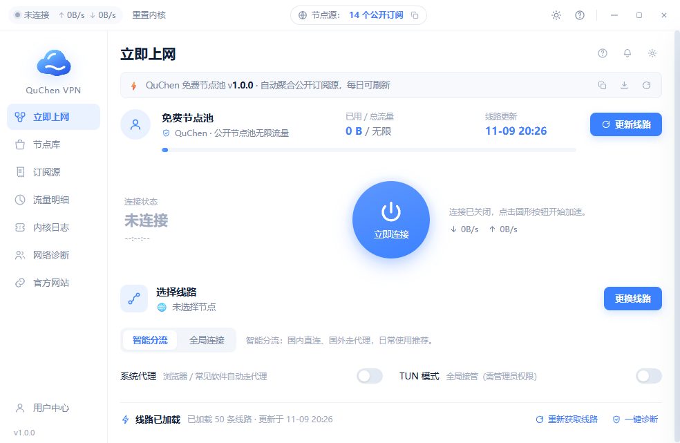

# QuChen VPN

> 版本：v1.0.7 · [下载](https://github.com/quchenace/QuChen-VPN/releases/latest)

Windows 桌面代理客户端：聚合互联网公开的免费节点订阅源，自动测速去重，一键连接。
界面参考 FlClash 类客户端的视觉语言，使用 **Python + WebView2 + mihomo 内核** 实现。



## 功能

- **自动节点池**：并发抓取 17 个公开免费订阅源（GitHub 仓库 / TG 收集器），支持镜像回退
- **真实测速**：TCP 预筛 → mihomo 分批并发延迟测试 → 二轮复测，只保留真正可用的线路
- **一键连接**：mihomo 内核托管，混合端口 + 系统代理自动接管，支持 TUN 模式（需管理员）
- **智能分流**：GEOSITE / GEOIP 规则，国内直连、国外走代理，可切换全局模式
- **线路管理**：线路抽屉、按国家筛选、搜索、单条延迟、全部测速
- **流量统计**：实时上下行速率、本次会话与按天累计流量
- **网络诊断**：内核、本地端口、出口连通性、系统代理四项体检
- **在线更新**：启动自动检查 GitHub Release，发现新版本可直接下载并静默替换重启

## 目录结构

```
app/
  main.py                 入口：无边框窗口 + pywebview API 桥
  backend/
    core.py               mihomo 进程管理与 REST API 封装、配置生成
    nodes.py              分享链接解析（vmess/vless/ss/trojan/hy2/tuic）、地区识别、字段校验
    subs.py               订阅源抓取（多镜像回退）、Clash YAML 与 base64 链接解析
    pool.py               节点池：抽样、TCP 预筛、分批测速、持久化
    service.py            业务层：设置、连接、测速、诊断、统计、更新
    sysproxy.py           WinINET 系统代理、开机自启、提权
    updater.py            GitHub Release 检查 / 下载 / 替换重启
  web/                    前端（原生 HTML/CSS/JS，无构建步骤）
runtime/core/             mihomo.exe + GEOIP.metadb / GEOSITE.dat / ASN.mmdb
assets/                   图标、内置种子节点池
tools/                    构建期脚本（种子池构建、图标生成、探测）
```

## 本地运行

```powershell
python -m pip install pywebview pythonnet requests pyyaml pillow pyinstaller
python app\main.py
```

需要 Windows 10/11 与 WebView2 运行时（系统自带 Edge 即有）。
`runtime/core/mihomo.exe` 需自行下载：<https://github.com/MetaCubeX/mihomo/releases>

## 打包

```powershell
powershell -ExecutionPolicy Bypass -File build.ps1
```

产物：`dist\QuChenVPN\QuChenVPN.exe`，压缩包 `release\QuChenVPN-win64.zip`。

## 在线更新机制

`app/backend/service.py` 中的 `UPDATE_REPO` 指向本仓库的 Release。
客户端启动后调用 `https://api.github.com/repos/<owner>/QuChen-VPN/releases/latest`：

1. 比较 `tag_name` 与内置版本号（语义化版本）
2. 有新版本时在「设置 → 软件更新」显示，点击下载对应 `QuChenVPN-win64.zip`
3. 下载完成后生成替换脚本：等待主进程退出 → robocopy 覆盖安装目录 → 重启新版本

发布新版本只需：修改 `APP_VER` → 打包 → 建 tag（如 `v1.0.1`）→ 上传 `QuChenVPN-win64.zip` 到 Release。

## 免责声明

节点全部来自互联网公开分享，客户端只做聚合与测速，不提供任何节点托管服务。
可用性由第三方维护者决定，请遵守所在地区法律法规，自行承担使用风险。

## 更新日志

### v1.0.7
- 修复：连接后实际未生效。连接流程改为后台执行，等待混合端口真正监听，接管系统代理后回读校验，并对出口做多轮连通性探测；出口不通时自动换线，仍不通则还原系统代理，避免“显示已连接但整台电脑没网”
- 修复：系统代理接管时残留 PAC 脚本导致规则绕过；接管/还原均做回读校验，退出时不再误还原他人代理
- 修复：TUN 模式在非管理员下直接失败，现自动降级为系统代理模式并记录原因
- 修复：设置里的「用户中心」文案已改为「设置」
- 修复：节点库只渲染部分节点。列表改为增量渲染（首批 120 条 + 加载更多），抽屉首批 200 条，搜索与标签筛选不再截断
- 修复：检查更新在网络环境异常时必定报网络错误。改为直连优先、失败再回退系统代理与镜像；只选 .zip 便携包作为更新源；错误信息区分私有仓库/无 Release
- 修复：更新后设置丢失。替换前完整备份，写入时排除 data、logs 与 settings.json，失败自动回滚
- 新增：设置页可填写仓库 Token，私有仓库也能检查更新
